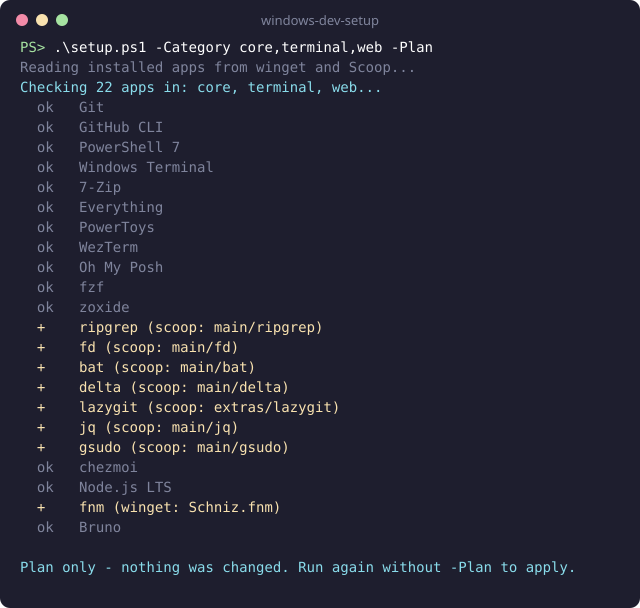

# windows-dev-setup

[](https://github.com/esraa-emadeldin/windows-dev-setup/actions/workflows/ci.yml)
[](LICENSE)


[](CONTRIBUTING.md)

A curated list of the apps a software developer actually needs on Windows, plus a small
script that installs them **safely**: it shows a plan first, skips anything you already
have, and can keep big installs and caches off your `C:` drive.



```powershell
git clone https://github.com/esraa-emadeldin/windows-dev-setup
cd windows-dev-setup
.\setup.ps1 -List                                  # browse the catalog
.\setup.ps1 -Category core,terminal,web -Plan      # see what would happen - changes nothing
.\setup.ps1 -Category core,terminal,web            # install
```

Inspired by "plan / apply" tools such as Terraform and macOS setup tools,
built only on what Windows already ships with: **winget**, plus **Scoop** for CLI tools.

## Why use this instead of a long blog-post list?

- **Plan first.** `-Plan` prints exactly what would be installed or changed, in a few seconds
  (it asks winget and Scoop once for everything installed, not once per app).
- **No duplicates.** An app is skipped if winget/Scoop already manages it *or* its command
  is already on your PATH (installed by hand, Chocolatey, anything).
- **Keep C: small.** `-InstallRoot D:\Dev\Tools` puts apps whose installers support it there;
  `-CacheRoot D:\Dev\.cache` moves npm, pip, uv, NuGet and Gradle caches.
- **Safe by design.** It never pipes a downloaded script into PowerShell. If Scoop is missing
  it prints the official install command for you to review and run.
- **Every pick explains itself.** Each app has a one-line "why" (`-List` shows them).
- **Tested.** Pester tests + PSScriptAnalyzer run in CI on every push.

## The catalog

| Category | Apps |
|---|---|
| `core` | Git, GitHub CLI, PowerShell 7, Windows Terminal, 7-Zip, Everything, PowerToys |
| `terminal` | WezTerm, Oh My Posh, fzf, zoxide, ripgrep, fd, bat, delta, lazygit, jq, gsudo, chezmoi |
| `editors` | VS Code, JetBrains Toolbox |
| `web` | Node.js LTS, fnm, Bruno |
| `python` | Python 3.13, uv |
| `java` | Temurin JDK 21, Maven, Gradle |
| `dotnet` | .NET 10 SDK |
| `cpp` | VS Build Tools, CMake |
| `containers` | WSL, Podman, Podman Desktop |
| `databases` | PostgreSQL 18, DBeaver |
| `notes` | Obsidian, Anki, Pandoc |
| `maintenance` | WizTree, Bulk Crap Uninstaller, Microsoft PC Manager |
| `ai` | Claude Code, Claude |

Use `-Category all` for everything. Everything is free; most of it is open source.

### Looking for...

- **Ghostty on Windows?** Ghostty has no official Windows build yet. **WezTerm** is the closest
  match: GPU-rendered, splits and tabs, one config file.
- **CleanMyMac on Windows?** Use the `maintenance` category: WizTree (what fills the disk),
  Bulk Crap Uninstaller (remove apps and leftovers) and Microsoft PC Manager (cleanup).
  Also turn on *Settings → System → Storage → Storage Sense*. Skip "registry cleaners".
- **Homebrew on Windows?** **Scoop** is the closest thing: `scoop install <tool>`, no admin
  rights, everything in one folder.

## Options

| Option | What it does |
|---|---|
| `-Category <list>` | Categories to install (default `core`). `all` = everything. |
| `-Plan` | Only show the plan. |
| `-List` | Print the catalog with a reason for each app. |
| `-InstallRoot <dir>` | Install supporting apps (and suggest Scoop) under this folder. |
| `-CacheRoot <dir>` | Move package-manager caches here (sets user environment variables). |
| `-CatalogPath <file>` | Use your own catalog (e.g. in a fork). |

## Requirements

- Windows 10 1809+ or Windows 11 with **winget** ("App Installer" from the Microsoft Store).
- PowerShell 7 recommended (`winget install Microsoft.PowerShell`). Windows PowerShell 5.1 works too (checked in CI).
- If scripts are blocked: `Set-ExecutionPolicy -Scope CurrentUser RemoteSigned`.

## Customize

Fork it and edit `catalog.json`. Each app looks like:

```json
{ "category": "terminal", "manager": "scoop", "id": "main/ripgrep", "name": "ripgrep",
  "command": "rg", "why": "Very fast code search (rg)." }
```

- `manager`: `winget`, `scoop` (id is `bucket/app`) or `msstore`.
- `command` (optional): if this command already works, the app is treated as installed.
- `location` (winget only): `true` if the installer honours `--location` (used with `-InstallRoot`).

## Development

```powershell
Install-Module Pester -RequiredVersion 6.2.0 -Scope CurrentUser -SkipPublisherCheck
Install-Module PSScriptAnalyzer -RequiredVersion 1.25.0 -Scope CurrentUser
Invoke-Pester ./tests
Invoke-ScriptAnalyzer -Path . -Recurse -Settings ./PSScriptAnalyzerSettings.psd1
./tools/Test-CatalogIds.ps1      # checks every id still exists in winget/Scoop (needs both)
./tools/New-Screenshot.ps1       # re-renders docs/screenshot.svg from a real -Plan run
```

## Roadmap

- [ ] `-Export`: turn the apps on *your* PC into a personal catalog.
- [ ] Profiles such as `student`, `web-dev`, `data` (pre-picked category sets).
- [ ] Optional interactive picker (checkboxes in the terminal). If this is ever built,
      it will likely be a small **Go** binary (Bubble Tea) that reads the same `catalog.json`.
      The PowerShell script stays the default because you can read it before you run it,
      and it needs no download or code signing.

Ideas welcome: [open an issue](https://github.com/esraa-emadeldin/windows-dev-setup/issues/new/choose).

## Contributing

See [CONTRIBUTING.md](CONTRIBUTING.md) and our [Code of Conduct](CODE_OF_CONDUCT.md).
Found a security problem? Please follow [SECURITY.md](SECURITY.md) instead of opening a public issue.

Licensed under [MIT](LICENSE).
